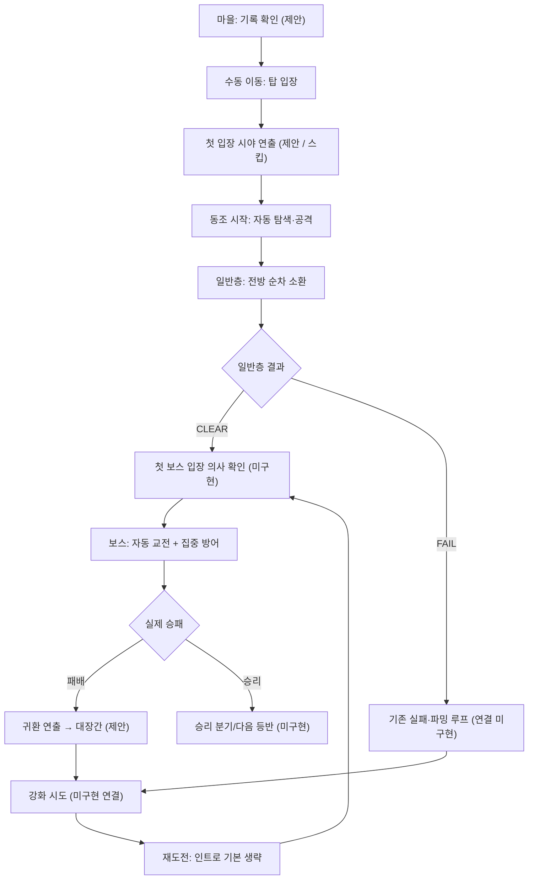

# 27. 첫 등반 스토리북 — 동조, 수호자, 첫 강화

> **문서 상태:** 신규 제안 (Narrative / UX Draft)  
> **적용 범위:** 첫 마을 입장 → 탑 첫 진입 → 동조 체험 → 첫 보스의 집중 방어 학습 → 첫 패배 및 귀환 → 강화 → 재도전  
> **기준:** 제공된 `25_DECISION_REGISTER.md`의 최신 결정을 최우선으로 적용. `26_COMBAT_PROTOTYPE.md`는 **뒤쪽의 2026-10-23 집중 방어 구현 기록**을 현 상태로 간주.  
> **주의:** 아래 장면·대사·튜토리얼·전환 UI는 **제안**이며, 실제 Unity 구현 완료를 의미하지 않는다.

---

## 0. 한눈에 보는 이야기

**핵심 한 문장:** 탑에 들어가면 몸은 스스로 싸운다. 그러나 수호자의 큰 일격 앞에서는 모험가의 의식이 필요하다. 첫 실패는 강화할 이유가 된다.

**주인공의 목적 — 신규 제안:** 마을에서 살아가기 위해서만이 아니라, **탑 최상층에 남았다는 '귀환하지 않은 등반자들의 기록'과 자신의 선배 모험가의 행방을 확인하기 위해** 오른다. 구체적인 혈연·실종 가족·예언된 선택받은 자 설정은 붙이지 않는다. 주인공 개인 사연은 후속 커스터마이징을 위해 열어 둔다. 첫 플레이에서 알 수 있는 목표는 오직 '탑 안쪽에 남은 기록을 찾는다' 정도다.

- **세계의 사실 [기존]:** 탑 안에서 육체와 의식이 *동조*해 무기·장비·경험에 따른 자동 전투가 나타난다. 탑이 인물을 조종하지 않는다.
- **플레이의 사실 [기존]:** 마을에서는 수동 이동, 탑에서는 자동 이동/공격. 보스의 강한 공격에만 `집중 방어` 입력. 일반 전투 및 도전에서 Rage는 없음.
- **경험의 목표 [신규]:** 처음엔 '왜 내 몸이 멋대로 움직이지?' → '내 장비와 준비가 전투를 바꾸는구나' → '보스의 일격은 내가 읽어야 한다' → '장비를 강화하면 다시 도전할 수 있겠구나' 순서로 **플레이**하게 한다.
- **실패의 성격:** 스토리상 패배를 권장·연출할 수는 있으나 **강제 사망·필중 즉사·방어 미입력 강제 패배를 넣지 않는다**. 처음부터 강한 빌드라면 성공 가능해야 한다. 이 경우 별도 성공 분기가 필요하다.

## 1. 원본 규칙과 신규 제안의 구분

| 구분 | 내용 | 근거/주의 |
|---|---|---|
| [확정 방향] | 모바일 세로 우선, 2D 수제 도트, 전방 중심 고정 방향 쿼터뷰, 제한 영역의 **레인 없는** 자유 자동 이동 | 25 |
| [확정 방향] | 일반 적은 주로 앞에서 합류; 영웅 자동 탐색/접근/공격; 이동·조준 분리 | 25 |
| [확정 방향] | 기본 베기는 플레이어 전방 기하 내 최대 3명에 동일 계수 직접 타격, 찌르기는 좁은 전방 1명. 과거 주 대상+35% 스플래시 **폐기** | 25, 26 |
| [확정 방향] | 보스도 같은 카메라·이동·조준 코어, 강공격 수동 `집중 방어`; 자동 돌진 회피는 **기본 해제** | 25 최신, 26 마지막 섹션 |
| [확정 방향] | 보스 무입력 승리를 보장하지 않지만, 무입력을 강제 사망 조건으로 만들지도 않음 | 25 |
| [확정 방향] | 탑 도전 유한 전투, 파밍 반복, Rage는 파밍에서만 수동 사용; 경험치 캐릭터 레벨 없음 | 00, 02, 07, 25 |
| [프로토타입 수치] | 집중 방어 지속 0.45초 / 쿨다운 4초 / 최종 보스 피해 70% 감소; 타이밍을 너무 빨리 쓰면 소멸 | 25, 26 — 출시 확정 밸런스 아님 |
| [프로토타입 수치] | Stage run 최초 5 / 이후 1.2초마다 1 / 생존 최대 8 / 총 50 / 제한 90초 | 07, 25, 26 — 실제 튜토리얼 전용 값 아님 |
| [신규 이야기] | 등반자들의 기록을 찾아 첫 탑에 도전한다는 동기, 기록의 실체, 마을 안내자 이름 | 본 문서 제안; 세계관 확정 아님 |
| [신규 UX] | 초반 조우 시야 연출, 등장 대사, 실패 후 단축 동선, 강화 안내 화살표 | 본 문서 제안; 현재 구현 아님 |

---

## 2. 초반 플레이 스토리보드

> 설계 원칙: 컷신보다 실제 조작/전투가 먼저. 한 번에 한 문장만 보여주고, 자동전투를 멈춰 놓고 긴 설명을 읽게 하지 않는다. **제안 대사는 초안이며 변경 가능하다.**

### S00. 마을 — 탑을 바라보는 첫 시선

**목표:** 주인공이 왜 탑에 가는지 **짧게** 알려 주고 플레이어가 직접 탑으로 걸어가게 한다.

- **화면:** 따뜻한 마을의 좁은 광장. 멀리 차가운 색의 탑 입구와 대장간 불빛. 마을 이동은 수동.
- **사건 [신규]:** 입구 게시판에 오래된 등반 기록 일부가 걸려 있다. 이름 몇 개는 읽히지만 돌아왔다는 표시는 없다. 주인공은 그 기록을 따라 탑 안쪽으로 가려 한다.
- **NPC: 입구 안내자(가칭 '문지기')**
  - “또 기록을 찾으러 왔나?”
  - “들어가면 걸음이 달라질 거야. 놀라지 마.”
- **게임 플레이:** 탑 문에 가까워지면 상호작용 아이콘. 메뉴 문구 `탑에 들어가기`.
- **미세 안내:** `마을에서는 직접 이동합니다.` 최초 1회만.
- **생략 규칙:** 재방문 때 게시판·소개 대사는 자동 재생하지 않음.
- **제작 범위:** 환경 오브젝트 1개 + NPC 1명 + 2줄 대사 + 탑 상호작용.

### S01. 첫 입장 — 위치와 위협을 짧게 보여주기

**목표:** 모바일의 좁은 화면에서도 '내 위치 / 앞으로 적이 온다'를 한번에 이해시킨다.

- **화면 [신규 연출 제안]:** 카메라 방향은 회전하지 않는다. 플레이어의 발 위치를 짧게 강조한 뒤 위쪽 진입구와 적 그림자 2~3개를 보여주고 자연스럽게 플레이어에게 돌아온다. 과도한 줌·화면 전환을 피한다.
- **사건:** 문이 닫히고 짧게 `동조 시작`이 나타난다.
- **NPC 대사:** 없음. 입구 문지기의 말이 마음속에 한 번만 짧게 떠오르도록 선택 가능.
- **인터랙션:** `건너뛰기` 표시. 설정에서 **초기 조우 연출 끄기** 가능. 파밍 반복 시 기본 생략.
- **중요:** 적 50마리를 전부 먼저 소환하거나 렌더링하지 않는다. 먼 그림자는 시각적 배경일 뿐 전투 객체 아님. 첫 구현은 연출 없이 기존 순차 스폰만으로도 성립한다.
- **UX 안내:** `전투 중 이동과 공격은 자동입니다.` 한 줄.

### S02. 동조 — 몸이 먼저 반응한다

**목표:** 조작하지 않는데도 싸우는 것을 '방치의 편의'가 아닌 **세계의 법칙**으로 받아들이게 한다.

- **사건:** 첫 적이 전방에서 다가온다. 주인공이 자동으로 적을 향해 접근·방향 전환하고 사선 베기 → 역베기 → 찌르기 등의 **실험 콤보**를 보여 준다. 이 순서가 모든 무기의 최종 필수 3타는 아님.
- **연출:** 휘두름 뒤 짧은 스파크, 피격 움찔, 사망 표기. 처음부터 컷신으로 동작을 강제하지 않는다.
- **주인공 속말 [신규]:** “움직이려고 한 게 아닌데… 몸이 먼저 반응했어.”
- **짧은 안내:** `탑과 동조 중 · 장비와 전투 방식에 따라 자동 행동합니다.`
- **규칙 주의:** 옛날의 '메인 타겟 100% + 주변 35%' 설명 금지. 각 베기의 전방 유효 대상에 개별 직접 타격. 게임 화면에 복잡한 계수 설명은 하지 않는다.

### S03. 첫 일반층 — 전방에서 조금씩 합류

**목표:** 전진감, 군집, 강화 필요성을 자연스레 예고한다.

- **화면:** 플레이어가 전방 교전 영역에서 움직이고, 화면 상단 진입 후보에서 적들이 간격을 두고 합류한다. 먼 적의 전부를 미리 생성하지 않는다.
- **사건:** 적이 금방 죽으면 다음 적이 이어서 들어온다. 처치 속도가 느리면 적이 앞으로 밀집한다. 플레이어는 짧게 재배치하거나 막히면 조건부 돌파를 시도한다.
- **짧은 안내:** `적이 몰릴수록 강화한 무기와 생존력이 중요합니다.`
- **불필요한 설명 배제:** 넉백, AI 선택 온도, 충돌 반경, 공격 수치 설명을 튜토리얼에 나열하지 않는다.
- **구현 연결:** 현 `Stage run`은 최초 5·순차 합류/처치/시간 종료까지 **프로토타입 있음**. 첫 입장 인트로, 자동 다음 층, 스토리 플래그, 보상은 **미구현**.
- **일반층 종료:** 전멸 시 바로 CLEAR 표시, 다음 진행의 UX는 개발 시 별도 연결.

### S04. 수호자 앞 — 잠깐의 멈춤

**목표:** 일반전과 다른 '보스의 큰 공격은 의식적으로 대응한다' 규칙을 안내한다.

- **진입:** 처음 만난 미돌파 보스 앞에서 **입장 의사를 받는 화면**을 제안한다. 그냥 일반층처럼 무인 자동 반복 진입시키지 않는다.
- **연출:** 차가운 회랑 끝에 수호자가 서 있다. 먼저 자세·무기 궤적으로 크고 느린 공격을 예고한다.
- **NPC: 탑 입구 안내자의 기록 음성/메모(새 장치 제안)**
  - “몸이 먼저 움직이는 건 믿어도 돼.”
  - “하지만 저 일격까지 본능에 맡기지는 마.”
- **버튼 안내:** `접근·공격은 자동 / 큰 공격이 닿기 직전에 [집중 방어]`
- **중요:** 손가락으로 이동하지 않는다. 보스 전용 회전 카메라·3레인·자동 완벽 회피·Rage를 도입하지 않는다.
- **현재 상태:** 입장 대기 UI, NPC 음성/메모, 보스 이야기 이벤트는 **미구현**.

### S05. 첫 집중 방어 — 설명보다 결과

**목표:** 한 번 실제로 눌러 보고, 너무 이르게 눌렀을 때의 차이도 체감하게 한다.

- **전투 진행:** 보스가 접근해 근접 공격 → 직선 돌진 예고 → 돌진 → 잠깐 빈틈 → 재접근 → 전방 휩쓸기 → 다시 근접 압박. 낮은 체력에서는 공격 템포 상승.
- **화면:** 돌진은 고정 직선 경로로 예고된다. 이동과 공격은 자동. **기본 자동 돌진 회피는 비활성**, 플레이어는 하단 `[집중 방어]`로 대응.
- **첫 힌트:** 예고 시작 순간 `충격이 닿기 직전에 누르세요` 한 줄과 버튼 시각적 강조. **자동으로 대신 눌러주지 않는다.**
- **성공 시:** 피해 감소 숫자/짧은 청록 반응. 보스 돌진 후 빈틈에 캐릭터가 자동 공격하는 모습을 보여 준다. `잘 버텼다. 이제 반격이다.` 같은 긴 튜토리얼 팝업 대신 반응만.
- **너무 일찍 누른 경우:** 방어 유효 시간이 먼저 끝나고 큰 피해. 사용자는 무효의 이유를 알아야 하므로 `너무 이른 방어` 1회 짧은 피드백을 **제안**한다. 현재 구현된 피드백으로 단정하지 않는다.
- **수치 표기:** 현 프로토타입 0.45초 / 4초 / 피해 70% 감소는 **검증용**. 최종 사용성 실험으로 조절. 공격을 멈추지 않고, 무적·완전 회피·즉시 반격을 제공하지 않는다.
- **훈련 강제 금지:** 성공 버튼 입력 체크를 통과해야 보스가 죽는 방식, 입력 실패 시 강제 즉사하는 방식은 채택하지 않는다.

### S06. 첫 패배 — 탑 밖으로 돌아오다

**목표:** '내가 못해서 끝났다'보다 '다음엔 강화해서 버틸 수 있다'로 연결한다.

- **기본 경로 [신규 서사]:** 일반 적과 달리 수호자의 연속 압박을 버티지 못해 체력이 0이 된다. 탑과의 동조가 흐려지고 시야가 어두워지며 마을 입구로 돌아온다.
- **대사 (마을 안내자):** “돌아왔군. 탑은 도망친 걸 탓하지 않아.”
- **짧은 두 번째 문장:** “같은 검이어도, 다시 벼려 가면 달라져.”
- **UI:** `돌파 실패` / `최고 도달 기록 유지`(정확한 기록 규칙은 진행 저장과 정합성 검토) / `대장간으로 가기`.
- **주의:** **보스 패배 → 마을 귀환은 신규 흐름 제안**. 현재 전투 프로토타입에는 보스 보상·진입·패배 귀환 플로우가 연결되지 않았음. **원본의 일반층 '1회 자동 재도전 후 파밍' 규칙을 보스에 자동 적용하지 말 것.**
- **스토리상 패배는 유도하되 강제하지 않는다:** 스펙과 방어 타이밍이 좋으면 첫 도전에서도 보스를 이길 수 있다. 그 경우 S06 대신 '첫 승리' 분기(S06-B)로 이동.

### S06-B. 첫 승리 — 예외 분기 (필수)

- **조건:** 첫 보스를 실제로 처치한 경우.
- **화면:** 별도 강제 패배 장면 없이 수호자 처치 결과를 표시.
- **NPC 짧은 대사:** “첫 동조에 그 문을 넘었어? 그 검을 잘 기억해 둬.”
- **다음 UX:** 일반적인 층 진행으로 이어질 수 있도록 준비하되, 구현 전에는 전용 모의 화면/더미 분기로 문서화. 보스 클리어 보상·다음 층 정책은 미확정.
- **원칙:** 기획된 패배 씬을 보여 주려고 플레이어의 실제 승리를 무효화하지 않는다.

### S07. 대장간 — 성장이 전투를 바꾼다

**목표:** 강화가 게임 핵심 성장축임을 짧은 체험으로 학습한다.

- **사건:** 마을 대장장이가 강화대를 가리킨다.
- **대사 (대장장이):**
  - “검을 바꿀 필요는 없어. 먼저 지금 든 걸 벼려 봐.”
  - “강화는 널 대신 싸워주진 않아. 하지만 버틸 시간은 벌어 주지.”
- **플레이:** 보유 무기 → 강화 화면 → 한 번 시도 → 성공/실패에 따른 즉각적 피드백. 수치는 실제 경제 설계에 따름.
- **핵심 규칙 [기존]:** 강화 실패 시 장비 파괴 없음. 세부 확률·실패 보정·하락·축복은 기존 강화 GDD를 참고해야 하며, 이번 첨부에는 원문이 없으므로 수치를 새로 정하지 않음.
- **초반 보장 정책 [미결]:** 첫 강화를 확정 성공시키거나 무료 재료를 지급할지는 게임 경제에 영향을 주는 **설정 변경/UX 제안**. 본 문서는 **확정하지 않는다**. 튜토리얼 작동에 필요한 초기 재화가 없을 경우 별도 설계 필요.
- **UI:** `강화 → 공격 수치가 어떻게 변했는지 비교`를 보여주되 실제 확률이나 보정을 숨기지 않는다.
- **구현 상태:** 이 스토리북 전용 강화 튜토리얼·대장장이 NPC·보상 연결 **미구현**. 전투의 임시 Damage Definition이 실제 장비 강화와 연동되어 있다는 근거 없음.

### S08. 재도전 — 첫 장면의 반복이 아니라 변화

**목표:** 같은 곳에 다시 갔지만 강해졌다는 감각.

- **입장:** 첫 진입 컷·조우 연출은 다시 강제하지 않는다. 최초 봤던 안내는 생략.
- **전투:** 강화 이후 달라진 실제 피해량, 적 처치 속도, 돌파 여유를 체감하게 한다. 결과를 속이기 위해 적 HP를 몰래 낮추지 않는다.
- **보스 재입장:** 미돌파 보스라면 사용자 확인 후 진입. 집중 방어를 누르는 타이밍은 여전히 플레이어 몫.
- **NPC 단문:** “이번엔, 전보다 오래 버틸 수 있을 거야.”
- **분기:** 승리 → 보스 통과/다음 등반; 다시 패배 → 기존 파밍·재화·강화 루프로 돌아가기. **특정 강화 횟수만큼만 재도전 가능하게 제한하지 않는다.**
- **Rage 없음:** 탑 Challenge/보스에서는 Rage 버튼을 노출하지 않음. 반복 파밍 단계에서만 Rage를 수동 사용.

---

## 3. 한눈에 보는 분기/안내 흐름

**UI 문구 예시** (각 1회, 1줄 원칙)

| 발생 상황 | 제안 문구 |
|---|---|
| 마을 최초 이동 | `마을에서는 직접 이동합니다.` |
| 탑 첫 진입 | `동조 시작` |
| 탑 첫 적 감지 | `탑 안에서는 이동과 공격이 자동으로 이루어집니다.` |
| 첫 밀집 | `적이 몰리면 전투가 어려워집니다.` |
| 첫 미돌파 보스 | `보스의 큰 일격은 집중 방어로 견디세요.` |
| 첫 위험 예고 | `충격이 닿기 직전에 집중 방어!` |
| 첫 사망 | `돌파 실패 · 장비를 강화하고 다시 도전하세요.` |
| 첫 강화 후 | `같은 탑, 달라진 무기.` |

---

## 4. 플레이와 이야기의 결합: 화면을 가리지 않는 원칙

1. **대사는 1~2문장으로 끊는다.** 설명할 기회가 많아도 전체 세계관과 탑의 기원을 한 번에 보여주지 않는다.
2. **조작 불가를 컷신으로 설명하지 않는다.** 자동 공격을 눈앞에서 보게 한 뒤 짧게 `동조`라고 이름을 붙인다.
3. **보스 집중 방어는 실제 피해 차이로 배운다.** 별도 리듬 게임·QTE 연속 입력을 추가하지 않는다.
4. **첫 패배는 빌드 성장의 계기다.** 강제 사망이나 스크립트 전투력 조작 대신, 실제 난이도로 압박을 제공한다.
5. **모바일 가독성이 우선이다.** 보스 예고 범위와 하단 방어 버튼을 대사창·연출이 가리지 않는다.
6. **반복 경험은 짧다.** 첫 조우 연출 건너뛰기, 설정상 끄기, 파밍 반복 생략은 기존 방향을 지킨다.
7. **탑 전용 자유 이동은 어디까지나 자동이다.** 보스에서만 조이스틱이 갑자기 나타나지 않는다.

## 5. 현재 구현과 스토리북 신규 작업 구분

> `26_COMBAT_PROTOTYPE.md` **끝부분의 2026-10-23 구현 기록** 기준. 과거에 있던 자동 돌진 회피 프로토타입은 비교 옵션이 되었으며 **현재 기본 보스 동작으로 안내하지 않는다.**

| 항목 | 현재 구현/검증 기록 | 이 문서가 요구하는 새 작업 |
|---|---|---|
| 레인 없는 자동 이동 / 공격 | 순수 전투 구현 및 테스트 기록 있음 | 실제 도트 스프라이트/튜토리얼 연출 |
| 전방 다수 베기·찌르기 / 피해 / 넉백 | 구현 기록 있음 | 장면별 안내 타이밍 조절 |
| 일반층 유한 순차 소환 / CLEAR·DEFEAT·TIME UP | `Stage run` 프로토타입 구현 기록 있음 | 인트로·다음 층·보상·자동 재도전·파밍 연결 |
| 보스 압박·돌진·후딜·휩쓸기·체력 절반 템포 변화 | 비교 보스 로직 및 테스트 기록 있음 | 정식 보스층 편입, 난이도 검증 |
| 집중 방어 버튼 / 큐 / 지속·쿨다운·피해 경감 | **최신 비교 구현 기록 있음**, 기본 자동 회피 해제 | 튜토리얼 하이라이트, 안내 문구/UX, 실제 터치 검증 |
| 2026-10-23 검증 | Unity 컴파일 관련 검증 및 별도 .NET 테스트 **87/87 통과 기록** | Unity Editor 재컴파일 완료·Unity Test Runner·실제 Play·모바일/Windows 검증 **미확인** |
| 주인공의 등반 동기 / 입구 NPC / 기록 오브젝트 | 구현 근거 없음 | **신규 스토리·월드 구성 작업** |
| 패배 귀환 / 대장간 / 강화 / 재도전 | 실제 전투→성장 루프 연결 근거 없음 | **신규 UI·씬·저장/보상·게임 로직 작업** |
| 첫 보스 패배/성공 분기 | 비교 보스의 정식 승패 흐름 미구현 | 보스 입장·제한 시간·승패·다음 진행 정책 확정 및 구현 |

**테스트 해석 주의:** 파일의 31/31, 40/40, 84/84 등은 각 시점의 **개발 이력**이다. 2026-10-23 최신 집중 방어 부분의 87/87은 분리된 .NET 실행 검증 기록으로, Unity 모바일 실기기 통과를 의미하지 않는다.

## 6. 별도 결정/설정 변경 요청이 필요한 항목

아래는 **기존 규칙을 조용히 변경하지 않는** 미결 사항이다.

| ID | 항목 | 제안 및 판단 필요 사항 | 현재 처리 |
|---|---|---|---|
| STORY-01 | 주인공이 탑을 오르는 개인 동기 | '돌아오지 않은 등반 기록을 찾는다'는 **새 설정**. 이름/혈연/특정 인물 미확정 | 승인 전까지 제안 |
| STORY-02 | 입구 안내자·대장장이의 캐릭터 | 직책만 설정, 고유 이름/종족/관계 미정 | 제안 |
| STORY-03 | 첫 보스가 등장하는 층 | 첨부 문서에 특정 층 번호 없음. 1층 보스라고 임의 확정하지 않음 | 미결 |
| UX-01 | 첫 패배 후 즉시 마을 복귀 vs 결과 화면에서 선택 | 초반 온보딩은 `대장간으로 가기` 추천 | 미결 |
| UX-02 | 첫 강화 재료 공급 / 첫 강화 성공 보장 | 일반 강화 확률·실패 규칙을 바꾸지 않는 방식 선호. 무료 재화 지급도 경제 결정 필요 | 미결 |
| UX-03 | 첫 집중 방어 학습 난이도 | 도움말 표시 타이밍과 방어 성공 여유만 조정. 보스 강제 패배/무적 불허 | 플레이 테스트 |
| UX-04 | 첫 보스 승리 보상·반복 클리어·제한시간 | `07`에 보스 제한 시간 방향만 존재. 지급량·재도전 정책 미정 | 미결 |
| UX-05 | 첫 조우 시야 연출 | 완전 별도 컷신보다 짧은 카메라 위치 강조 추천. 스킵/토글 유지 | 프로토타입 검증 |
| SAVE-01 | 패배 후 최고층·강화·입장 상태 저장 | 기존 핵심 루프는 유지하되 실제 persistence 연결 필요 | 미구현 |

**권장 승인 범위:** 우선 STORY-01의 동기를 세계관 임시 설정으로만 사용하고, 나머지는 *프로토타입 UX 가설*로 구현·검증해 확정한다. 새로운 보스 전용 이동 규칙, 강제 패배, 강화 확정 성공 같은 시스템 변경은 이번 스토리북에 포함하지 않는다.

## 7. Codex 구현용 순서 (본 문서가 구현 완료를 주장하지 않음)

1. **스토리 없이** 현 `CombatPrototype`의 Stage run과 Charge boss / FOCUS GUARD를 실제 Unity Play·세로 모바일 비율에서 먼저 확인.
2. 첫 보스 입장 게이트, 방어 안내 한 줄, 성공/실패 결과 상태를 **작은 기능 단위로** 연결. 미돌파 보스 자동 진행 중단 규칙 지키기.
3. 첫 입장 `동조 시작`과 위치/전방 안내를 스킵 가능한 UI로 구현. 실제 50마리 선행 생성 금지.
4. 마을 입구 대사 2줄과 첫 보스 안내를 UI 이벤트로 추가하되 순수 전투 로직과 분리.
5. 실패 → 대장간 안내 → **별도 명세에 따른 실제 강화** → 재도전 연결. 강화용 임시 피해 수치를 실제 저장 성장으로 위장하지 않기.
6. 첫 승리 분기 테스트, 중도 종료/재시작, 첫 입장/재입장/파밍 스킵 상태, 집중 방어 입력과 도전/파밍 Rage 격리 검증.

**Acceptance criteria:**
- 설명 스킵해도 자동 전투와 집중 방어 입력이 정상 작동한다.
- 첫 보스의 자동 돌진 회피가 기본 동작으로 돌아오지 않는다.
- 집중 방어를 일찍/적시에 누른 경우 실제 피해 차이가 확인된다.
- 패배가 강제 스크립트가 아니며, 첫 승리 분기가 작동한다.
- 강화 후 표시/피해 수치가 실제 저장된 장비 성장과 일치한다.
- 어떤 신규 UI도 도트 전투의 예고 영역과 집중 방어 버튼을 가리지 않는다.
- 구현 안 된 기능을 `완료`라고 README / 진행 기록에 적지 않는다.

---

## 부록 A. 이번 문서에 사용한 첨부 자료

- `25_DECISION_REGISTER.md` — **최상위 충돌 해결 기준**, 2026-10-23 집중 방어 변경 포함
- `26_COMBAT_PROTOTYPE.md` — **후반 최신 변경 및 검증 한계**를 현 구현 기준으로 사용
- `00_GAME_OVERVIEW.md` — 게임 목표·강화 중심 성장·보스 참여
- `01_WORLD_AND_TOWER.md` — 동조, 수동 마을 이동/자동 탑 전투, 의식적 집중
- `02_CORE_LOOP.md` — 도전→실패→파밍→강화→재도전→환생
- `07_TOWER_CHALLENGE.md` — 유한 일반층, 일반층 실패 처리, 보스 입장 UX 미구현

**별도 참조하지 못한 자료:** 실제 전체 Unity 프로젝트·`04_COMBAT.md`·`23_COMBAT_PRESENTATION_2026_10.md`·강화 원문 등은 이번 첨부에 없음. 따라서 문서의 대사, 첫 강화 재화, 첫 보스 층수, 최종 밸런스 수치를 이미 확정된 내용처럼 쓰지 않았다.
