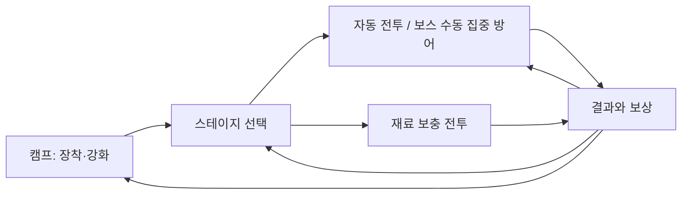

# 31. 캠프·강화·스테이지 플레이 흐름

기준일: 2026-10-23. 사용자 승인 범위는 임시 작업대의 클릭 UI·강화 피드백을 정리하고 여러 스테이지를 연결해 한 번의 성장 흐름을 확인하는 것이다. 기존 비교 씬은 보존하고 별도 `Assets/Scenes/JourneyPrototype.unity`에서 검증한다. 최종 아트/UI, 정식 층별 경제나 전체 탑 구현을 의미하지 않는다.

## 플레이 순서

- 캠프: 무기/방어구4개 선택 카드, 장착 표시, 다음 전투 ATK·DEF·HP, 선택 아이템의 단계/능력치/성공률/비용을 표시한다.
- 강화: 클릭 즉시 세션 계산을1회 처리하고 약.65초 동안 버튼을 잠근다. 결과 패널에 성공·축복·실패·역행, 이전→이후 단계/보너스, 실제 사용 재료와 다음 성공률을 표시한다. 강화/장비 선택은 기존 화면과 버튼을 유지한 채 텍스트·색·활성 상태만 갱신한다. 화면 전체 페이드는 아래 버그 수정으로 제거했으며 버튼 눌림/비활성 색은 유지한다. 제작 시간이나 확률 연출을 경제 규칙으로 새로 추가한 것이 아니다.
- 선택: 처음에는1번만 열리고 클리어하면 다음을 해금한다. 열린 스테이지는 다시 선택 가능하며 보스도 명시적으로 ENTER를 눌러 진입한다. 자동 등반/자동 실패 재시도는 이번에 구현하지 않는다.
- 전투: 일반전은 기존 자동 이동/공격·자유 필드·순차 합류를 유지한다. HP/남은 시간/처치 수를 표시하고 비교용1/5/8/12·렌더러 토글은 이 씬의 플레이 UI에 노출하지 않는다. 보스는 동일 View에서 수동 FOCUS GUARD 버튼을 제공한다. 수동 회피·자동 포션·새 패턴은 추가하지 않는다.
- 결과: CLEAR/DEFEAT/TIME UP, 경과 시간·처치·실제 준 피해·잔여 HP·시작 ATK/DEF·획득 재료를 보여준다. 다음 스테이지(클리어 시), 같은 상대 재도전, 선택 화면, 캠프/강화로 이동한다. 마지막 보스 이후에는 다음 층 버튼을 만들지 않는다.
- 재료 보충: 언제든 선택 가능한 Supply Run을 반복한다. 유한4마리 전투이며 정식 지속 Farming/오프라인 정산/Rage가 아니다.

## 화면과 전투 상태의 경계

실제 Unity 씬을 매번 로드하는 대신 하나의 씬 안에서 **uGUI Canvas 화면**을 교체한다. 장비 세션이 화면 이동으로 사라지지 않고 카메라 방향도 바뀌지 않는다. ScreenSpaceOverlay·CanvasScaler(기준400×720, Expand)와 Safe Area를 사용하며 Input System의 UI 모듈로 마우스/터치 버튼 입력을 받는다. 현재는 내장 폰트를 사용하는 임시 영어 UI다. 최종 한국어 폰트/현지화·아트·음향·복잡한 전환은 후속 작업이다.

전투 중 CAMP / PAUSE는 기존 전투를 일시정지한다. 캠프에서 강화해도 정지한 Fighter는 바꾸지 않는다. RESUME은 기존 HP/시간/스탯 그대로 이어간다. 스테이지 화면은 새 입장이 정지한 전투를 대체하고 HP를 초기화한다고 안내한다. 선택 화면을 열기만 해서는 보상/해금/새 전투를 발생시키지 않는다. 새 전투 ENTER/RETRY에서만 장비 스냅샷을 다시 적용한다.

결과는 전투당1회만 확정하고 클리어에만 재료를 지급한다. 다음 프레임/화면 왕복으로 중복 지급하지 않는다. 클리어 후 같은 스테이지를 새로 시작하면 다시 보상 가능하다. 사망·시간 초과·중단은 클리어 보상을 주지 않고 기존 장비/재료를 보존한다. 전투 중 캠프로 돌아가는 행위를 실패로 기록하지 않는다. 장비/해금/재료/결과는 Play 종료나 씬 재로드 시 초기화하며 저장·서버는 없다.

## 스테이지 비교값 — 최종 밸런스 아님

기본 능력치는 새 씬 생성 시 EquipmentPrototype에서 복사한다. 몬스터 기본 HP/공격력에 아래 배율을 곱하며, 기존 빠른 적/중장갑/보스의 타입별 배율과 모션은 그 다음에 적용한다. 방어 공식 K20은 유지한다.

| 선택 | 구성 | 총/초기/동시 상한 | 기본 HP/공격 배율 | 합류/제한 | 클리어 보상 |
|---|---|---|---|---|---|
| 01 THE GATE | 일반 | 6/2/3 | .65/1 | 2초/60초 | 30G/2석 |
| 02 THE RUSH | 일반1:빠른 적2 반복 | 12/3/5 | .85/1.1 | 1.1초/75초 | 45G/3석 |
| 03 IRON WATCH | 중장갑 | 8/2/4 | 1.2/1.35 | 1.8초/90초 | 60G/4석 |
| 04 THE WARDEN | 기존 돌진/휩쓸기 보스 | 1/1/1 | 보스 HP 유지/1.5 | 초기 배치/90초 | 90G/6석 |
| SUPPLY RUN | 일반 | 4/1/2 | .5/.75 | 2초/60초 | 40G/3석 |

현재 경로와 배율은 `PrototypeJourney.cs`의 작은 불변 목록이다. 정식 층 데이터/ScriptableObject 카탈로그·드랍 테이블을 미리 생성하지 않는다. 기존 CombatDamage/PrototypeEquipment 에셋은 수정하지 않는다. 난이도는 같은 공간에서 적 구성/압박으로 구분하며 새 배경 아트나 실제 고저차를 추가하지 않았다. 모든 스테이지가 무강화로 통과하거나 특정 강화 단계에서 반드시 막힌다고 보장하는 최종 밸런스는 아니다.

## 코드 책임

- `Assets/Scripts/Progression/PrototypeJourney.cs`: 경로 정의, 화면 상태, 순차 해금, 시도·결과1회 확정. Unity 비의존 순수 C#.
- `Assets/Scripts/Presentation/CombatPrototypeFlow.cs`: 기존 CombatPrototype의 partial 표현/흐름 구성. uGUI 생성, 버튼/강화 결과/전환, 기존 전투 결과와 장비 세션 보상 연결.
- `CombatPrototype.cs`: opt-in 시작/업데이트 연결, 경로별 StageSettings/적 구성 적용. 핵심 CombatSimulation/DamageProfile/StageEncounter 계산은 변경하지 않는다.
- `Assets/Editor/CombatPrototypeSceneBuilder.cs`: `Enhancement Tower → Create Journey Prototype Scene`. 새 씬만 만들고 기존 파일이 있으면 열기만 한다. 사용자가 수정한 원본 씬을 덮어쓰지 않는다.
- `Assets/Tests/EditMode/EquipmentTests.cs`: 순차 해금/실패·중복 확정/재료 전투·보스 상한/일시정지 화면 상태 검증.

## Unity 수동 검증

1. Unity6000.6.4f1에서 `Assets/Scenes/JourneyPrototype` 열기→Game9:16→Play. 캠프 카드/재료/장착/선택 상태를 확인한다. 씬이 없을 때만 위 생성 메뉴를 쓴다.
2. 무기 선택→ENHANCE. 누른 색/짧은 잠금/결과·단계·ATK 변화·재료 차감·다음 확률을 본다. 실패도 재료가 들고 장비가 남는지 확인한다. 재료 부족 시 강화 버튼이 비활성화되는지 본다.
3. CHOOSE STAGE→01 ENTER. 다른 미해금 스테이지는 누를 수 없어야 한다. HP/처치/예약/시간을 보고 CLEAR 후 결과 보상1회와02 해금을 확인한다.
4. RESULT→NEXT STAGE 또는 RETURN TO FORGE→강화→STAGES→같은 상대를 다시 시작한다. 새 스탯/처치·잔여 HP가 달라지는지 비교한다. 한 단계 강화가 매 타격의 정수 피해를 반드시 바꾼다고 단정하지 않는다.
5. 전투 중 CAMP / PAUSE→시간/HP 정지→강화→RESUME. 기존 전투 스탯과 HP로 이어져야 한다. 새 스테이지를 시작하면 HP/시간 초기화와 새 장비 스탯 적용을 확인한다.
6. Supply Run→CLEAR→보상40G/3석→RETRY로 새 전투를 완료하면 다시 지급. 같은 결과 화면에서 기다리거나 화면 왕복으로 중복 지급하지 않는지 본다.
7.03 클리어→수동 보스 입장→전조와 FOCUS GUARD, 무입력/적시 입력을 비교한다. 자동 돌진 회피나 새 수동 이동이 생기면 안 된다. 보스도90초 종료/사망/클리어 후 결과와 정지가 필요하다.
8. 테스트용 낮은 Hero Health로 DEFEAT, 낮은 공격력으로 TIME UP을 확인하고 원복한다. 실패는 보상/해금 없이 장비 보존·재도전/강화/보충으로 이어져야 한다.9:19.5·Safe Area·실제 터치·Windows/모바일도 별도 확인한다.

## 검증 상태

아래에 자동/실제 화면 검증과 미검증 범위를 기록한다. 다음 최소 단계는 사용자가 이 경로를 직접 플레이해 강화/재도전 동기가 읽히는지 확인한 뒤, 가장 큰 문제 한 가지를 골라 조정하는 것이다. 자동 포션·수동 회피·정식 저장/파밍·추가 스토리를 동시에 확대하지 않는다.

### 이번 검증 결과

- Unity6000.6.4f1 컴파일 및 Test Runner EditMode **100/100 통과**(기존98 + 해금/화면 상태2). 기존 전투/장비/비율 방어·집중 방어 회귀를 포함한다.
- 임시 Metal Play 검증기는 비활성 CombatPrototype을 한 번 초기화하고 uGUI Button의 실제 연결 콜백을 실행했다. 캠프→강화/잠금 중 중복 차감 방지→선택/입장→일시정지·강화 후 기존 스탯으로 복귀→클리어/다음 해금→보스 패배→보충/반복 보상→실패 무보상을 확인했다. 물리 마우스/터치를 직접 누른 검증은 아니다.
- 540×960 렌더 캡처에서 캠프 선택 카드·강화 상세·스테이지 잠금·결과/보상/다음 행동 배치를 확인했다. 캡처는 검증기에서 임시 ScreenSpaceCamera로 투영한 이미지이며 제품은 ScreenSpaceOverlay다. 모든 기기의 Safe Area/화면 전환 애니메이션/실제 입력 품질을 보장하는 검증은 아니다.
- 초기 검증기 캡처의 Canvas 갱신/페이드 시점을 수정했다. 별도 보스 시간 초과 검증도 기존 float 고정 Tick의 누적 길이에 맞춰5400틱으로 실행해 TIME UP/무보상을 확인했다. 실제 업데이트의 남은 시간 제한도 같은 고정 Tick을 기준으로 계산한다. Editor Search 인덱서 내부 예외는 게임 코드와 분리한다.
- 미검증: 실제 클릭·터치/음향 체감, 모바일·Windows 빌드/성능, Safe Area 실기기, 최종 난이도·강화 경제, 포션 포함 장기 균형. 저장/자동 등반/정식 Farming/새 수동 회피·패턴은 미구현이다.

## UI 재생성·화면 배율 버그 수정

- 증상: 아이템 선택/장착/강화·강화 잠금 해제마다 페이지 전체를 파괴하고 alpha0부터 다시 생성해 뒤의 전투장이 번쩍 보였다. 데이터 변경에도 입력 대상 Button을 교체했으므로 이전 콜백 직접 호출 검증만으로 실제 입력 안정성을 확인하기 부족했다.
- 수정: 캠프 페이지/버튼을 유지하고 재료·선택 카드·장착·상세/강화 결과만 갱신한다. 강화 처리 자체에도 중복 요청 방어를 둔다. 화면을 유지하는 구조에서도 다른 아이템 선택 후 장착 버튼은 현재 선택한 아이템을 조회해 사용한다. 메뉴 화면은 처음부터 불투명하게 표시한다.
- 배율: 가로폭만 맞추던400×800 설정은 가로/낮은 창에서 화면 하단이 위쪽 카드와 겹칠 수 있었다.400×720 Expand로 양 축이 들어오도록 계산하고 미세한 크기 차이로 반복 재생성하지 않게 한다. 배율2를 고정하는 코드는 없다. Unity Game 탭의 Scale은 Editor 미리보기 확대율로 Canvas 스케일과 별개이며 프로젝트 코드가 강제로 바꾸지 않는다.
- 수동 회귀: 장비4개를 번갈아 선택/장착하고 연속 강화→배경 번쩍임 없이 현재 아이템·비용·실패 보정·결과가 바뀌는지 본다. 강화 중 연타는1회 비용만 소비해야 한다. 잠금 해제 뒤 같은 버튼을 다시 누를 수 있어야 한다. 세로9:16/9:19.5와 가로16:9에서 버튼이 겹치지 않는지, 화면 왕복 후에도 선택과 장착이 유지되는지 확인한다.

### 수정 검증
- 임시 Unity Play 검증기에서 MonoBehaviour를 명시적으로1회 초기화하고, 가상 Mouse의 누름/뗌을 Input System에 큐잉하여 실제 EventSystem/GraphicRaycaster를 통한 클릭을 확인했다(직접 Button.onClick 호출 아님). 첫 무기 강화 성공·비용1회, 잠금 중 같은 버튼 유지·해제, 두 번째 아이템 선택/강화, 현재 선택 아이템 장착, 선택/캠프 왕복이 통과했다. 데이터 갱신 전후 페이지와 강화 Button의 동일 인스턴스도 확인했다. 물리 마우스·실기기 터치를 직접 검증한 것은 아니다.
- 검증 당시 Game View642×1156, Safe Area 내부 Canvas435.25×720, 실제 scale1.475로 표시되어2배 고정이 아님을 확인했다. 초기 검증기의 자동 Start/프레임 진행 대기는 명시적 초기화와 Player Loop 진행으로 수정한 뒤 재실행했다.
- 수정 후 Unity6000.6.4f1 EditMode **100/100 통과**. 별도 기존 흐름 Play 검증기도 다시 통과해 정지/복귀·해금·보상 중복 방지·보충/재도전·패배·보스 TIME UP 무보상을 확인했다. 변경 Markdown 링크와 diff 공백 검사도 통과했다. 여러 종횡비와 실기기 Safe Area/터치·Windows는 수동 검증이 남는다.
